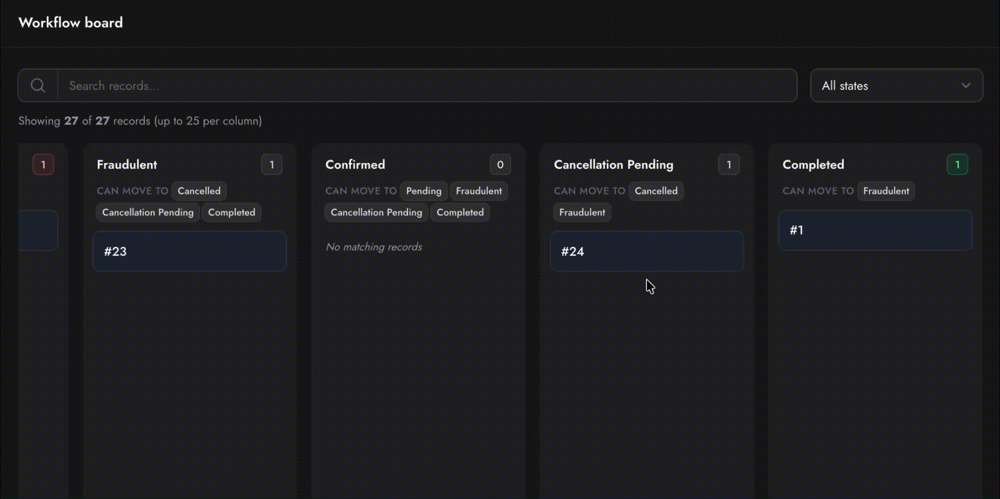

# Filament Model States



State-aware **Kanban board** and **status timeline** components for Filament v5.

Built to sit on top of:

- [`spatie/laravel-model-status`](https://github.com/spatie/laravel-model-status) > powers the **timeline** (status history log)
- [`spatie/laravel-model-states`](https://github.com/spatie/laravel-model-states) > powers **transition validation** and column discovery on the Kanban board (optional but recommended)


Filament Model States provides a plug and play auto-detection for enums, Spatie Model States, or plain database values.
## Requirements

- PHP 8.3+
- Laravel 11–13
- Filament v5
- `spatie/laravel-model-status` (required for timeline + optional status logging on Kanban moves)
- `spatie/laravel-model-states` (optional for server-side transition validation and config-driven column order)

## Installation

```bash
composer require usamamuneerchaudhary/filament-model-states
```
```
php artisan vendor:publish --tag="filament-model-states-config"
```

```
php artisan filament:assets
```
After upgrading the package, re-run `php artisan filament:assets` and hard-refresh your browser if Kanban styles or drag-and-drop stop working.

---

## Quick start

### 1. Prepare your model

**Option A: backed enum (simplest)**

```php
use Spatie\ModelStatus\HasStatuses;

class Order extends Model
{
    use HasStatuses;

    protected function casts(): array
    {
        return [
            'workflow_state' => WorkflowState::class,
        ];
    }
}
```

```php
enum WorkflowState: string
{
    case Draft = 'draft';
    case Pending = 'pending';
    case Completed = 'completed';

    public function label(): string
    {
        return match ($this) {
            self::Draft => 'Draft',
            self::Pending => 'Pending',
            self::Completed => 'Completed',
        };
    }

    /** @return array<string, list<string>> */
    public static function transitions(): array
    {
        return [
            'draft' => ['pending'],
            'pending' => ['completed'],
            'completed' => [],
        ];
    }
}
```

**Option B: Spatie Model States**

```php
use Spatie\ModelStates\HasStates;
use Spatie\ModelStatus\HasStatuses;

class Booking extends Model
{
    use HasStates;
    use HasStatuses;

    protected function casts(): array
    {
        return [
            'status' => BookingState::class,
        ];
    }
}
```

### 2. Add the Kanban to a resource list page

```php
use Usamamuneerchaudhary\FilamentModelStates\Concerns\HasStateKanbanBoard;

class BookingResource extends Resource
{
    use HasStateKanbanBoard;

    // ...
}
```

```php
// Pages/ListBookings.php
protected function getHeaderWidgets(): array
{
    return [
        BookingResource::getStateKanbanBoard(),
    ];
}
```

That's it. Columns, labels, transitions, and column order are auto-detected.

### 3. Verify detection (optional)

```bash
php artisan filament-model-states:make-kanban Booking --detect --state-field=status
```
---

## Kanban board

### Plug-and-play widget

Point the board at any model, no subclass required:

```php
use Usamamuneerchaudhary\FilamentModelStates\Widgets\ModelStateKanbanBoard;

// List page header widgets
ModelStateKanbanBoard::for(Booking::class)

// Non-default state field
ModelStateKanbanBoard::for(Booking::class, stateField: 'status')
```

### Resource trait (recommended)

Add `HasStateKanbanBoard` to your Filament resource, then register on the list page:

```php
use Usamamuneerchaudhary\FilamentModelStates\Concerns\HasStateKanbanBoard;

class OrderResource extends Resource
{
    use HasStateKanbanBoard;
}
```

```php
protected function getHeaderWidgets(): array
{
    return [
        OrderResource::getStateKanbanBoard(),
    ];
}
```

### Generated widget (optional)

If you prefer a dedicated widget class:

```bash
php artisan filament-model-states:make-kanban Booking --resource=BookingResource
```

This creates `app/Filament/Widgets/BookingKanbanBoard.php` and prints wiring instructions. Use `--force` to overwrite, `--detect` to inspect without generating.

### Custom widget (full control)

Extend `StateKanbanBoard` when you need complete control over columns, queries, card content, or authorization:

```php
use Usamamuneerchaudhary\FilamentModelStates\Widgets\StateKanbanBoard;

class OrderStatusBoard extends StateKanbanBoard
{
    protected function getModel(): string
    {
        return Order::class;
    }

    protected function getStateField(): string
    {
        return 'workflow_state';
    }

    protected function getColumns(): array
    {
        return ['draft', 'pending', 'processing', 'completed', 'cancelled'];
    }

    protected function getAllowedTransitions(): ?array
    {
        return WorkflowState::transitions();
    }

    protected function getColumnLabel(string $key): string
    {
        return WorkflowState::from($key)->label();
    }

    protected function getCardTitle(Model $record): string
    {
        return "Order #{$record->reference}";
    }

    protected function getCardSubtitle(Model $record): ?string
    {
        return $record->customer_name;
    }

    protected function getQuery(): Builder
    {
        return Order::query()->where('team_id', filament()->getTenant()->id);
    }
}
```

---

## Auto-detection

`ModelStateKanbanBoard` resolves everything through `StateConfigurationResolver`:

| Priority | Source | Columns | Transitions | Labels |
|----------|--------|---------|-------------|--------|
| 1 | **Backed enum cast** | `Enum::cases()` | `Enum::transitions()` or `Model::getStateTransitions()` | `Enum::label()` |
| 2 | **Spatie Model States cast** | `BookingState::getStateMapping()` | `BookingState::config()` allowances | `State::label()` or headline of `$name` |
| 3 | **Database fallback** | Distinct values in the state column | `Model::getStateTransitions()` if defined | Headline of stored value |

### State field detection

The resolver looks for, in order:

1. `workflow_state`, `state`, or `status` attributes in `$casts`
2. Any enum cast whose field name contains `state` or `status`
3. Any Spatie state cast on a field containing `state` or `status`
4. Any enum or Spatie state cast

Pass an explicit field when ambiguous:

```php
ModelStateKanbanBoard::for(Booking::class, stateField: 'status')
```

---

## Spatie Model States

### Transitions

When your model uses `spatie/laravel-model-states`, the Kanban reads allowances directly from your abstract state's `config()`:

```php
abstract class BookingState extends State
{
    public static function config(): StateConfig
    {
        return parent::config()
            ->default(Initiated::class)
            ->allowTransition(Initiated::class, AwaitingPayment::class, ToAwaitingPayment::class)
            ->allowTransition(Initiated::class, Expired::class, ToExpired::class);
    }
}
```

On drag-and-drop:

1. **UI**: only allowed target columns are highlighted; invalid targets are blocked client-side.
2. **Server**: `$currentState->canTransitionTo($targetStateClass)` is called before saving.
3. **Persist**: `$currentState->transitionTo($targetStateClass)` runs your transition classes (`ToAwaitingPayment`, etc.).
4. **History**: if the model uses `HasStatuses`, `setStatus()` is called automatically.

### Column keys and labels

| Property | Used for                                                                |
|----------|-------------------------------------------------------------------------|
| `public static string $name = 'initiated'` | Column key (DB value / morph class)                                     |
| `label()` | Column header label (optional)                                          |
| `description()` | **Not** used for Kanban headers, keep this for tooltips or detail views |

Without `label()`, headers are generated from `$name` (e.g. `initiated` → "Initiated").

```php
class Initiated extends BookingState
{
    public static string $name = 'initiated';

    public static function label(): string
    {
        return 'Initiated';
    }

    public static function description(): ?string
    {
        return 'Booking has just been created';
    }
}
```

### Column ordering

Columns are ordered automatically. Priority:

1. **`columnOrder()`** on the abstract state class (explicit override)
2. **`$sortOrder`** or **`sortOrder()`** on each concrete state class
3. **Config registration order**: default state first, then the order `allowTransition()` calls appear in `config()`
4. **Filesystem discovery**: remaining states in directory order

Explicit order example:

```php
abstract class BookingState extends State
{
    public static function columnOrder(): array
    {
        return [
            'initiated',
            'awaiting_payment',
            'pending',
            'confirmed',
            'completed',
            'cancelled',
        ];
    }
}
```

Per-state sort order:

```php
class Initiated extends BookingState
{
    public static int $sortOrder = 1;
    public static string $name = 'initiated';
}
```

---

## Enum-based workflows

Define transitions on the enum:

```php
public static function transitions(): array
{
    return [
        'draft' => ['pending', 'cancelled'],
        'pending' => ['processing', 'cancelled'],
        'processing' => ['completed', 'failed'],
        'completed' => [],
        'cancelled' => ['draft'],
        'failed' => ['pending'],
    ];
}
```

Or on the model:

```php
public static function getStateTransitions(): array
{
    return WorkflowState::transitions();
}
```

Enum case order in the PHP file is used as column order.

---

## Optional model hooks

### Search

Add a query scope to enable the board's search box:

```php
public function scopeFilamentKanbanSearch(Builder $query, string $search): Builder
{
    return $query->where(function (Builder $query) use ($search): void {
        $query->where('reference', 'like', "%{$search}%")
            ->orWhere('customer_name', 'like', "%{$search}%");
    });
}
```

### Status history on Kanban moves

Use `HasStatuses` on the model. Each successful drag calls:

```php
$record->setStatus($targetColumn, 'Moved via Kanban board');
```

Customize the reason by extending `StateKanbanBoard::persistStateChange()`.

### Spatie state class resolution

If column keys don't map cleanly to state classes, add to your model:

```php
public static function getStateClassForColumn(string $column): string
{
    return match ($column) {
        'awaiting_payment' => AwaitingPayment::class,
        default => throw new InvalidArgumentException("Unknown column [{$column}]"),
    };
}
```

---

## Status timeline (Infolist)

Shows a vertical history of status changes from `spatie/laravel-model-status`.

### Basic usage

```php
use Usamamuneerchaudhary\FilamentModelStates\Infolists\Components\StatusTimelineEntry;

public static function infolist(Schema $schema): Schema
{
    return $schema->components([
        StatusTimelineEntry::make('status_history')
            ->label('Status history')
            ->limit(20),
    ]);
}
```

### Resource trait

```php
use Usamamuneerchaudhary\FilamentModelStates\Concerns\HasStatusTimelineInfolist;

class OrderInfolist
{
    use HasStatusTimelineInfolist;

    public static function configure(Schema $schema): Schema
    {
        return $schema->components([
            Section::make('Status history')
                ->schema([
                    self::statusTimelineEntry(),
                ]),
        ]);
    }
}
```

The timeline reads `$record->statuses()`, shows each state with reason and duration, and highlights the current one. Status labels match the Kanban board (enum `label()`, Spatie state `label()`, or a headline fallback).

### Options

```php
StatusTimelineEntry::make('status_history')
    ->limit(20)              // max entries shown (no pagination UI)
    ->hideReason()           // hide the reason text
    ->emptyStateLabel('No changes yet.');
```

---

## Kanban features

- **Drag-and-drop** between columns with SortableJS (bundled, no CDN)
- **Server-side validation**: invalid moves are rejected with a notification; cards snap back
- **Confirmation modal** before saving a move (configurable)
- **Search**: filters cards when `scopeFilamentKanbanSearch` is defined
- **Column filter**: dropdown to focus on a single column
- **Totals**: SQL counts per column; cards are paginated per column
- **Transition hints**: "Can move to" chips under each column header
- **Authorization**: `Gate::authorize('update', $record)` on every move

---

## Artisan command

```bash
# Inspect auto-detected configuration
php artisan filament-model-states:make-kanban Booking --detect

# Specify a non-default state field
php artisan filament-model-states:make-kanban Booking --detect --state-field=status

# Generate a widget class
php artisan filament-model-states:make-kanban Booking --resource=BookingResource

# Overwrite an existing generated widget
php artisan filament-model-states:make-kanban Booking --force
```

Example `--detect` output:

```
 Model              App\Models\Booking
 State field        status
 Detection source   spatie-model-states
 Columns            initiated, awaiting_payment, pending, ...
 Transitions        {"initiated":["awaiting_payment","expired"], ...}
```

---

## Configuration

Published to `config/filament-model-states.php`:

```php
return [
    'timeline' => [
        'per_page' => 25,
        'show_reason' => true,
        'date_format' => 'M j, Y \a\t g:i A',
    ],

    'kanban' => [
        // Filament color tokens per column key
        'column_colors' => [
            'draft' => 'gray',
            'pending' => 'warning',
            'processing' => 'info',
            'completed' => 'success',
            'cancelled' => 'danger',
            'failed' => 'danger',
        ],

        // Show a danger notification when a drag is rejected
        'notify_on_invalid_transition' => true,

        // Max cards rendered per column (totals always use SQL counts)
        'records_per_column' => 25,

        // Confirm in a modal before persisting a move
        'confirm_before_move' => true,
    ],
];
```

Unlisted column keys fall back to `gray`. Override per-widget via `getColumnColor()` on a custom `StateKanbanBoard` subclass.

---

## How transition validation works

When a card is dropped on a new column, `moveRecord()` runs **server-side**:

1. Loads the record with a row lock.
2. Authorizes `update` on the record.
3. Checks the transition:
   - **Spatie Model States**: `$state->canTransitionTo($targetStateClass)`
   - **Enum / manual map**: `getAllowedTransitions()` array
   - **No rules**: all moves allowed
4. Persists via `transitionTo()` (Spatie) or direct attribute save (enum/DB).
5. Optionally logs to status history via `setStatus()`.

The browser cannot bypass step 3, enforcement lives in your state machine, not JavaScript.

---

## Where to register the board

| Location | How                                                                                            |
|----------|------------------------------------------------------------------------------------------------|
| **Resource list page** (recommended) | `getHeaderWidgets()` → `YourResource::getStateKanbanBoard()`                                   |
| **Custom page** | `ModelStateKanbanBoard::for(YourModel::class)` in `getHeaderWidgets()` or `getFooterWidgets()` |
| **Panel widgets** | Only if you want a global board, usually prefer resource-scoped                                |

---

## Compatibility

- **Filament v5** (`filament/filament ^5.0`)
- **Laravel 11–13**
- **PHP 8.3+**
- `StatusTimelineEntry` uses the Filament v5 schemas/infolists API
- Kanban CSS and JS are bundled via `FilamentAsset`, run `php artisan filament:assets` after install

---

## License

[MIT](LICENSE)
